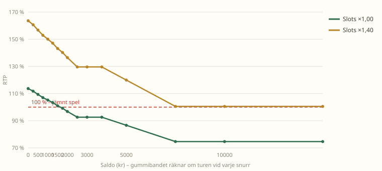
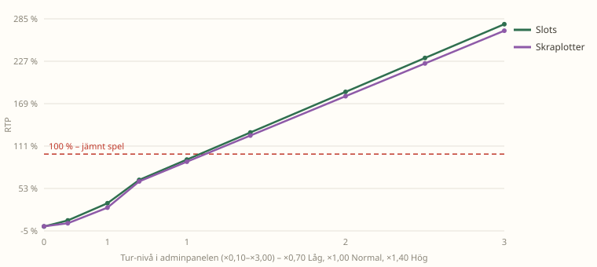

# Simulering: slotsens marginal och alla tur-nivåer

> Allt i spelhallen är **spelmynt utan värde**. Siffrorna här finns bara för att spelet ska vara
> roligt och rättvist – inte för att tjäna pengar.

Den här rapporten kommer från `npm run simulera` (`tools/simulera.js`). Verktyget läser
vinsttabeller, symbolvikter och tur-formler **direkt ur källkoden**, så simuleringen kan inte
glida ifrån spelet. Alla tal nedan är från en körning med 400 000 snurr per nivå, 400 000
videopokerhänder och 400 000 blackjackrundor.

## Kortversionen

| Fråga | Svar |
| --- | --- |
| Vad har slotsen för marginal? | **7,4 %** vid normal tur (RTP 92,6 %). |
| Hur mycket svänger gummibandet? | RTP **74,6 % → 113,7 %**, alltså marginal **+25,4 % → −13,7 %**. |
| Var går brytpunkten för jämnt spel? | Vid **slotLuck ×1,08**. |
| Vad händer på "Hög tur" (×1,40)? | RTP **129,6 %** – spelaren har 29,6 % övertag. |
| Hur långt går spannet? | Tur-nivån kan sättas **×0,10–×3,00** (RTP 1,0 %–277,7 %). |
| Hur ofta vinner man något? | **20,2 %** av snurren (1,6 vinstrader i snitt när det blir vinst). |
| Hur ofta blir det STORVINST-toast (≥15×)? | **0,72 %** av snurren vid normal tur. |
| Spelar insatsens storlek roll? | Nej – skillnaden är under 0,6 procentenheter. |
| Hur ofta spelar man bort hela kontot? | **15,7 %** av sessionerna (2 500 kr, 20 kr/snurr, max 1 000 snurr). |

## 1. Husets marginal i slots – exakt uträknat

Varje snurr är 5 hjul × 3 rutor med 20 fasta vinstlinjer. Eftersom varje ruta dras oberoende
kan den **exakta** förväntade utbetalningen räknas ut för alla 8⁵ = 32 768 symbolkombinationer
per linje i stället för att gissa med slumptal.

| Tur-nivå | RTP neutral | Marginal | RTP lågt saldo (×1,35) | RTP högt saldo (×0,70) |
| --- | --- | --- | --- | --- |
| ×0,10 (lägsta möjliga) | 1,0 % | 99,0 % | 1,2 % | 0,9 % |
| ×0,25 (Mycket låg) | 9,3 % | 90,7 % | 10,9 % | 8,0 % |
| ×0,70 (Låg) | 64,7 % | 35,3 % | 76,1 % | 55,2 % |
| **×1,00 (Normal)** | **92,6 %** | **7,4 %** | 113,7 % | 74,6 % |
| ×1,40 (Hög) | 129,6 % | −29,6 % | 163,6 % | 100,5 % |
| ×2,00 (Mycket hög) | 185,2 % | −85,2 % | 238,6 % | 139,4 % |
| ×3,00 (Extrem, max) | 277,7 % | −177,7 % | 363,6 % | 204,1 % |

**Läs det så här:** vid normal tur behåller huset 7,4 öre av varje satsad krona. Med "Hög tur"
betalar slotsen ut 1,30 kr per satsad krona – då är det spelaren som har övertaget, inte huset.
På "Extrem" (×3,00) betalas 2,78 kr ut per satsad krona, och på "Mycket låg" (×0,25) behåller
huset 91 öre.

Tur-nivån kan sättas var som helst mellan **×0,10 och ×3,00** – antingen med snabbknapparna
Mycket låg / Låg / Normal / Hög / Mycket hög / Extrem, eller genom att skriva in ett eget värde
i fältet under knapparna.

### Brytpunkter

| RTP-mål | Tur-nivå som krävs |
| --- | --- |
| 110 % | ×1,19 |
| 105 % | ×1,13 |
| **100 %** | **×1,08** |
| 95 % | ×1,03 |
| 90 % | ×0,97 |
| 80 % | ×0,86 |

Snabbknapparna ligger på var sin sida om brytpunkten: Låg (×0,70) är hård mot spelaren, Normal
(×1,00) ger huset en liten marginal och Hög (×1,40), Mycket hög (×2,00) och Extrem (×3,00) ger
spelaren ett allt större övertag.

## 2. Gummibandet – marginalen följer saldot

Gummibandet räknar om turen före varje snurr utifrån saldot jämfört med startsaldot 2 500 kr.
Nedan: samma slots, men med den tur spelaren faktiskt har vid det saldot.



| Saldo | Tur | RTP (×1,00) | RTP (×1,40) | Marginal (×1,00) |
| --- | --- | --- | --- | --- |
| 0 kr | ×1,35 | 113,7 % | 163,6 % | −13,7 % |
| 250 kr | ×1,32 | 111,7 % | 160,6 % | −11,7 % |
| 500 kr | ×1,28 | 109,4 % | 156,8 % | −9,4 % |
| 1 000 kr | ×1,21 | 105,2 % | 150,1 % | −5,2 % |
| 1 500 kr | ×1,14 | 101,0 % | 143,1 % | −1,0 % |
| 2 000 kr | ×1,07 | 96,8 % | 136,4 % | 3,2 % |
| 2 500 kr | ×1,00 | 92,6 % | 129,6 % | 7,4 % |
| 3 750 kr | ×1,00 | 92,6 % | 129,6 % | 7,4 % |
| 5 000 kr | ×0,90 | 86,6 % | 119,9 % | 13,4 % |
| 7 500 kr | ×0,70 | 74,6 % | 100,5 % | 25,4 % |
| 10 000 kr+ | ×0,70 | 74,6 % | 100,5 % | 25,4 % |

Gummibandet gör precis det det ska: en spelare som nästan spelat bort allt får tillbaka mer
(101–114 %), och en spelare med en stor hög betalar mer (75–87 %). Vid start är det neutralt.

## 3. Tur-nivå mot RTP (båda spelen)



| Tur-nivå | Slots | Skraplotter |
| --- | --- | --- |
| ×0,70 | 64,7 % | 62,7 % |
| ×1,00 | 92,6 % | 89,6 % |
| ×1,40 | 129,6 % | 125,4 % |

Skraplotterna har en något brantare kurva eftersom de har färre vinstnivåer (hela vinsten
multipliceras rakt av med turen).

## 4. Spelar insatsen någon roll?

Alla utbetalningar avrundas till hela kronor (`luckPayout()`), så små insatser skulle i teorin
kunna "läcka" någon tiondels procent. Så är det inte:

| Insats | RTP ×0,70 | RTP ×1,00 | RTP ×1,40 |
| --- | --- | --- | --- |
| 10 kr | 65,55 % | 93,17 % | 129,40 % |
| 20 kr | 65,04 % | 92,58 % | 129,69 % |
| 50 kr | 65,02 % | 92,69 % | 129,62 % |
| 100 kr | 64,74 % | 92,58 % | 129,61 % |
| 500 kr | 64,79 % | 92,58 % | 129,61 % |
| 5 000 kr | 64,80 % | 92,58 % | 129,61 % |

Insatsen kan alltså väljas fritt utan att det påverkar marginalen.

## 5. Var kommer utbetalningarna ifrån?

Vid normal tur och ×1,00, andel av de 92,6 % RTP:

| Rad | Chans per linje | Andel av RTP |
| --- | --- | --- |
| 🔔 klocka 3 st (1,45×) | 0,339 % | 10,6 % |
| 💎 diamant 3 st (1,90×) | 0,230 % | 9,5 % |
| 🍒 körsbär 4 st (1,65×) | 0,252 % | 9,0 % |
| 🍒 körsbär 5 st (5,20×) | 0,080 % | 8,9 % |
| 🍇 plommon 4 st (2,10×) | 0,183 % | 8,3 % |
| 🍇 plommon 5 st (6,80×) | 0,052 % | 7,6 % |
| 7 sjua 3 st (2,30×) | 0,146 % | 7,3 % |
| 🍉 melon 4 st (2,50×) | 0,128 % | 6,9 % |
| 🍉 melon 5 st (8,50×) | 0,032 % | 5,9 % |
| 🔔 klocka 4 st (3,70×) | 0,055 % | 4,4 % |
| BAR 4 st (3,20×) | 0,055 % | 3,8 % |
| 💎 diamant 4 st (5,20×) | 0,033 % | 3,7 % |
| 7 sjua 4 st (8,50×) | 0,018 % | 3,3 % |
| 🔔 klocka 5 st (14×) | 0,010 % | 3,2 % |
| BAR 5 st (12,5×) | 0,010 % | 2,8 % |
| 💎 diamant 5 st (23×) | 0,005 % | 2,7 % |
| 7 sjua 5 st (42×) | 0,002 % | 2,3 % |
| ★ fem jokrar (85×) | 0,00003 % | 0,02 % |

Per symbol: klocka 18,2 %, körsbär 17,9 %, plommon 15,9 %, diamant 15,8 %, sjua 12,8 %,
melon 12,8 %, BAR 6,6 %, stjärnan 0,02 % av RTP.

De små vinsterna står för ungefär hälften av utbetalningarna – det är därför kontot rör sig
jämnt i stället för att stå still och plötsligt explodera.

## 6. Träffchans, storvinster och svit (Monte Carlo)

400 000 snurr per nivå, insats 20 kr:

| Tur-nivå | RTP | Träffchans | Snitt per snurr | Std.avvikelse | Största vinst |
| --- | --- | --- | --- | --- | --- |
| ×0,10 | 1,0 % | 0,5 % | 0 kr (0,01×) | 3 kr | 336 kr |
| ×0,25 | 9,5 % | 4,0 % | 2 kr (0,09×) | 12 kr | 1 152 kr |
| ×0,70 | 64,7 % | 20,1 % | 13 kr (0,65×) | 40 kr | 1 478 kr |
| **×1,00** | **91,8 %** | **20,2 %** | **18 kr (0,92×)** | **57 kr** | **3 067 kr** |
| ×1,40 | 128,9 % | 20,1 % | 26 kr (1,29×) | 80 kr | 3 918 kr |
| ×2,00 | 184,8 % | 20,3 % | 37 kr (1,85×) | 114 kr | 7 060 kr |
| ×3,00 | 278,4 % | 20,2 % | 56 kr (2,78×) | 171 kr | 7 560 kr |

Monte Carlo-siffrorna hamnar inom ±1 procentenhet från de exakta – bra kvitto på att
formlerna hänger ihop.

| Tur-nivå | Vinst ≥10× | Vinst ≥15× (STORVINST) | Vinst ≥50× | Längsta nit-svit | Vinstrader vid vinst |
| --- | --- | --- | --- | --- | --- |
| ×0,10 | 0,00 % | 0,00 % | 0,000 % | 1 431 snurr | 1,12 |
| ×0,25 | 0,06 % | 0,01 % | 0,000 % | 238 snurr | 1,23 |
| ×0,70 | 0,72 % | 0,28 % | 0,005 % | 48 snurr | 1,61 |
| ×1,00 | 1,74 % | 0,68 % | 0,018 % | 49 snurr | 1,61 |
| ×1,40 | 3,02 % | 1,45 % | 0,072 % | 53 snurr | 1,62 |
| ×2,00 | 6,13 % | 2,88 % | 0,170 % | 50 snurr | 1,61 |
| ×3,00 | 8,68 % | 6,14 % | 0,538 % | 57 snurr | 1,62 |

På normal tur händer 45–55 snurr utan vinst i rad någon gång under 400 000 snurr – på de lägsta
nivåerna är motsvarande svit över 200 snurr (och över 1 400 på ×0,10). Spelar man 20 kr
per snurr är det ungefär 1 000 kr utan att något händer – det är därför gummibandet och
dagliga bonusar behövs.

## 7. En hel spelkväll med gummibandet på

4 000 sessioner: start 2 500 kr, 20 kr per snurr, max 1 000 snurr, turen räknas om efter varje
snurr utifrån saldot.

| Mätvärde | Värde |
| --- | --- |
| Andel som spelar slut på kontot | **15,7 %** |
| Snitt saldo efter 1 000 snurr | 1 871 kr |
| Median saldo | 1 847 kr |
| 10 % sämsta utfall | 12 kr |
| 10 % bästa utfall | 3 625 kr |
| Snitt-RTP under sessionen | 95,6 % (mot 92,6 % utan gummiband) |
| Snitt antal snurr innan kontot tar slut | 678 snurr |

Gummibandet höjer den upplevda RTP:n med cirka 3 procentenheter över en session, och de flesta
kommer hem med ungefär tre fjärdedelar av startkapitalet kvar.

## 8. De andra spelen – samma tur-nivåer

### Skraplotter

Vinstchans 36,7 %, trappan 1,5× / 2,5× / 4× / 8× / 20× / 50×, lottpriser 10–500 kr.
RTP är exakt densamma för alla priser (89,60 % vid normal tur).

| Tur-nivå | RTP neutral | Marginal | Lågt saldo | Högt saldo |
| --- | --- | --- | --- | --- |
| ×0,10 | 1,2 % | 98,8 % | 1,5 % | 1,0 % |
| ×0,25 | 5,4 % | 94,6 % | 6,7 % | 4,3 % |
| ×0,70 | 62,7 % | 37,3 % | 71,9 % | 54,8 % |
| **×1,00** | **89,6 %** | **10,4 %** | 108,3 % | 73,7 % |
| ×1,40 | 125,4 % | −25,4 % | 156,4 % | 98,8 % |
| ×2,00 | 179,2 % | −79,2 % | 229,1 % | 136,4 % |
| ×3,00 | 268,8 % | −168,8 % | 350,2 % | 199,2 % |

Brytpunkter: 100 % RTP vid **×1,12**, 95 % vid ×1,06, 90 % vid ×1,00.

### Videopoker (Jacks or Better)

Spelet beror på spelarens val, så här simuleras en förenklad men rimlig strategi (behåll
färdiga händer, fyra till färg/stege, lågt par, höga kort).

| Tur-nivå | RTP | Marginal | Träffchans |
| --- | --- | --- | --- |
| ×0,10 | 0,7 % | 99,3 % | 0,3 % |
| ×0,25 | 5,2 % | 94,8 % | 2,5 % |
| ×0,70 | 48,6 % | 51,4 % | 23,7 % |
| **×1,00** | **94,3 %** | **5,7 %** | 44,4 % |
| ×1,40 | 131,5 % | −31,5 % | 44,3 % |
| ×2,00 | 187,8 % | −87,8 % | 44,3 % |
| ×3,00 | 282,4 % | −182,4 % | 44,3 % |

Byter man bort alla fem korten varje gång blir RTP bara 34,3 % – strategin är alltså värd
ungefär 60 procentenheter. En skicklig spelare kan pressa siffran några procent högre än 94,3 %.

### Blackjack

6 kortlekar, dealern står på mjuk 17, blackjack 3:2, dubbel efter split tillåten, en splitt,
basic strategy och **snäll dealer på** (dealern får aldrig blackjack på given och aldrig stå
på 21).

| Tur | RTP | Marginal | Vinstchans | Lika |
| --- | --- | --- | --- | --- |
| ×0,70 | 98,8 % | 1,2 % | 50,9 % | 8,7 % |
| **×1,00** | **115,1 %** | **−15,1 %** | 50,9 % | 9,1 % |
| ×1,35 | 133,9 % | −33,9 % | 51,2 % | 8,7 % |

Med **snäll dealer av** spelar bordet som ett vanligt kasino: då ligger RTP på cirka 98 % vid
neutral tur, dealern får blackjack på given i ungefär 4,7 % av givarna och vinstchansen är
omkring 43 %. Skillnaden är medveten – den snälla dealern finns för att en giv inte ska vara
förlorad innan spelaren hunnit trycka på en knapp.

Blackjack är det spel där gummibandet märks mest: en vinst betalar 2× bara vid tur ×1,00 –
20 kr satsat ger 40 kr vid neutral tur, men 34 kr vid lägsta och 47 kr vid högsta turen.

## 9. Allt i en tabell

| Spel | RTP vid normal tur | Marginal | Spann över hela gummibandet |
| --- | --- | --- | --- |
| Slots ×1,00 | 92,6 % | 7,4 % | 74,6 % – 113,7 % |
| Slots ×1,40 | 129,6 % | −29,6 % | 100,5 % – 163,6 % |
| Skraplotter ×1,00 | 89,6 % | 10,4 % | 73,7 % – 108,3 % |
| Skraplotter ×1,40 | 125,4 % | −25,4 % | 98,8 % – 156,4 % |
| Videopoker ×1,00 | 94,3 % | 5,7 % | 0,7–282 % över tur-nivåerna |
| Blackjack ×1,00 (snäll dealer) | 115,1 % | −15,1 % | 98,8 % – 133,9 % |

## Vad siffrorna betyder för inställningarna

Inget av detta är ändrat i spelet – det är bara mätvärden. Men de ger ett underlag:

- **Normal tur (×1,00) är den enda nivån där huset har en rimlig marginal** i slots
  (7,4 %) och skraplotter (10,4 %). Det är en bra standard.
- **Allt över ×1,08 ger spelaren övertag.** "Hög" (×1,40) ger 25–32 %, "Mycket hög" (×2,00)
  ger 79–88 % och "Extrem" (×3,00) ger 168–182 % i slots, skraplotter och videopoker. De två
  sista är rena festlägen – de skapar mynt ur tomma luften och tömmer spel-ekonomin.
  Vill man ha hög tur men ändå ett litet spelaröverskott ligger **×1,05–×1,08** nära jämnt spel.
- **"Låg" (×0,70) är hård** – 35–51 % marginal. "Mycket låg" (×0,25) och ×0,10 är ännu
  hårdare (90 %+ marginal): då betalar bara de riktigt stora raderna, och på ×0,10 vinner man
  knappt något alls (0,5 % träffchans, längsta nit-svit 1 431 snurr i testet).
- **Insatsen spelar ingen roll** – 10 kr och 5 000 kr ger samma RTP, så gränserna för min/max
  kan sättas efter spelglädje i stället för matematik.
- **Gummibandet gör sitt jobb:** spelarens session hamnar på ~96 % RTP och 84 % av sessionerna
  har pengar kvar efter 1 000 snurr.

## Samma siffror finns i adminpanelen

Fliken **Ekonomi** i adminpanelen räknar samma sak direkt i webbläsaren, men med de
inställningar som gäller just nu: RTP och marginal för slots och skraplotter per tur-nivå och
saldo, brytpunkten för jämnt spel och en knapp som snurrar 20 000 gånger och visar träffchans,
största vinst, längsta nit-svit och hur många som spelar slut på kontot. Panelen importerar
vinsttabellerna från `slots.js` och `scratch.js`, så den kan aldrig visa en annan siffra än
spelet använder.

## Köra om simuleringen

```bash
npm run simulera
```

Tar cirka 40 sekunder och skriver även om diagrammen i `docs/img/`. Vill du ändra antal snurr
eller lägga till en tur-nivå är det bara konstanterna högst upp i respektive avsnitt i
`tools/simulera.js` som ska justeras – alla tabeller räknas fram på nytt.
